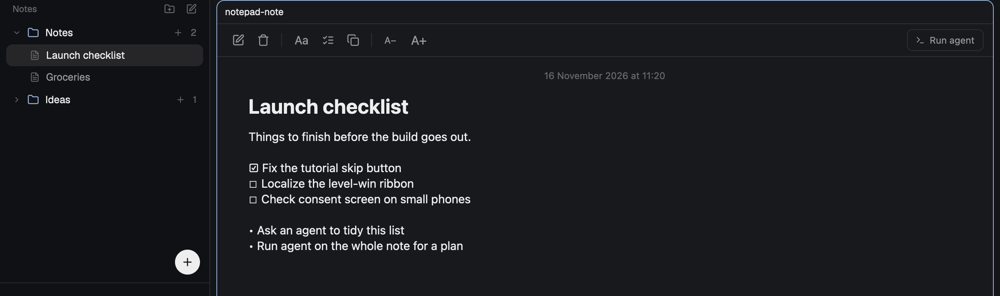

# Notepad for Herdr

An Apple Notes–style layout for [Herdr](https://herdr.dev): your notes in folders on the left,
a clean editor in the middle, and your agents grouped by project underneath. Select text in a
note, right-click, and hand it straight to a new agent.



## Features

- **Notes in folders.** New note, new folder, a `+` on each folder, drag notes between folders,
  Shift/Cmd-click to select several, right-click to rename or delete (deleted notes go to
  `~/Notes/.Trash`).
- **Apple Notes–like editor.** The first line is the title; Enter moves to the body. Line
  styles (`Aa`), checklists (`☐`/`☑`), lists that continue on Enter, `- text` + Enter turns into a
  to-do, and text size `A−` / `A+`.
- **Notes are plain Markdown.** Every note is a `.md` file in `~/Notes`, so agents can read and
  edit them, and the open note updates by itself when they do.
- **Agents from your notes.** Right-click selected text → *New agent with selection*, or press
  *Run agent* to start one with the whole note. Uses Claude Code if installed, else your other
  agents.
- **Agents grouped by project.** Add a project folder from the footer, start an agent in it with
  `+`, close all of its agents with `✕`, drag headers to reorder. A small readout shows how much
  of your Claude Code limits is left.

## Install

Ask an agent in Herdr:

> add herdr.dev/layouts/Artunn/notepad

or copy it in by hand:

```sh
git clone https://github.com/Artunn/notepad.git
cp notepad/layouts/notepad.json ~/.config/herdr-app/layouts/
cp -R notepad/mods/notepad* ~/.config/herdr-app/mods/
```

Then add `"layout:notepad": { "ctrl-n": "notepad.new" }` to `~/.config/herdr-app/keys.json`
for Ctrl+N, and switch to the layout with `ctrl-shift-l` (or `herdr-app do layout.switch
'{"name":"notepad"}'`).

Want your notes somewhere else? Make `~/Notes` a link to that folder:
`ln -s /path/to/your/notes ~/Notes`.

## Privacy

- Notes stay on your machine, in `~/Notes`.
- The usage readout (macOS) reads Claude Code's own sign-in from your keychain and sends it only
  to Anthropic (`api.anthropic.com/api/oauth/usage`) every 5 minutes, to show your remaining
  limits. Nothing is sent anywhere else. Without a Claude Code sign-in it just shows `usage ?`.

## Build it yourself

[`RECIPE.md`](RECIPE.md) describes the whole layout so an agent can rebuild or adapt it from
scratch.
