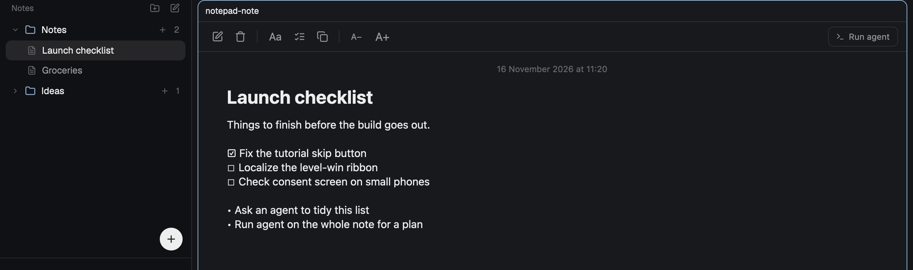

# Notepad

An Apple Notes–style Herdr: the sidebar shows your notes in folders instead of spaces, the main
area is a quiet note editor (big title line, body below, a small Notes-like toolbar), and the
agents list underneath is grouped by project folder. Select text in a note, right-click, and hand
it to a new agent. Notes are plain `.md` files in `~/Notes`, so agents can read and improve them;
an open note picks up their edits by itself.

## What you see

Left sidebar (268px, `chrome` background), top to bottom:

- **Brand row** (46px): the shipped `workspace-chrome` header (Herdr logo, search, sidebar toggle).
- **Notes** (half the remaining height): header "Notes" (11.5px, `dim`) with a folder-plus
  (New folder) and square-pen (New note) button. Below it one column of rows:
  - a "Notes" root row for loose notes, then one row per folder: chevron, folder icon (`accent`),
    name, a small `+` (new note in that folder) and the note count (12px, `dim`);
  - under an open folder, its notes (28px rows, 30px left indent, file-text icon), newest
    first, each showing its title (the note's first line, "New Note" when empty);
  - the open note's row has the `selected` background, others `hover` on hover;
  - a round 32px `+` button (`solid` background) floats at the bottom right: New note.
- **Agents** (the other half): header "Agents" plus a tiny usage readout `5h 98% · 7d 81%`
  (remaining Claude Code limits, 10.5px, `dim`, red under 20%), then a `+` (the tab bar's new
  agent/terminal menu) and a sort button (Priority / Grouped by project).
  - Grouped by project (the default): a header per project folder (its basename, full path as
    tooltip) with a red `✕` right after the name and a `+` at the far right; agents below it.
  - Each agent row: program icon, the agent's topic (13px), the time since its state changed,
    and its status mark.
- **Footer** (41px): Settings on the left and a folder-plus button snapped right (Add project).

Main area: the shipped `tabs` bar on top, panes below. A note opens as a tab holding one
`notepad-note` pane:

- **Toolbar** (42px, bottom border): New note, Delete, divider, `Aa` (line styles), Checklist,
  Copy, divider, `A−` / `A+`, flexible gap, a bordered "Run agent" button on the right.
- **Page** (40px side padding, system UI font, i.e. SF Pro on macOS): a centered date line
  ("12 November 2026 at 16:30", 12px, `dim`), the title line (bold, 1.73× the body size), then
  the body (default 15px, line height 1.35, soft wrap).

## How it behaves

Notes:

- The first line is the title; Enter in the title moves to the body and saves at once, so the
  sidebar row and the tab name update immediately. Typing saves every 500ms.
- Only one note tab exists at a time: picking another note reuses it (no flash of the old one),
  the way switching agents works. Ctrl+N (in this layout) makes a new empty note.
- Empty notes stay; they are only deleted on purpose.
- Click a note to open it; Shift-click selects a range, Cmd/Ctrl-click toggles; with more than
  one selected a bar shows "N selected · Delete · Cancel".
- Drag a note onto a folder (or the Notes row) to move it. Right-click a note: Rename / Delete.
  Right-click a folder: Delete. Deleting moves to `~/Notes/.Trash` (recoverable).
- The open note re-reads its file every 1.5s while nothing typed is unsaved, so outside edits
  (an agent's) show up without reopening.

Editor:

- `Aa` menu: Body, • Bulleted, – Dashed, 1. Numbered, ▏ Block Quote (toggles the prefix on the
  caret line). Checklist cycles `☐` → `☑` → none.
- Enter on a list line continues the list (`☐` after `☐`/`☑`, the next number, the same bullet);
  Enter on an empty item ends the list. `- text` + Enter turns the line into `☐ text` and starts
  a new `☐` line.
- `A−` / `A+` change the text size (11–28px), shared by all notes.
- Copy puts the whole note on the clipboard. Run agent starts the preferred installed agent
  (Claude Code first) in a new tab with the note as its first message.
- Right-click in the body: a small menu at the pointer, "New agent with selection" / "New agent
  with whole note". The selection stays highlighted while the menu is open.
- A sent one-line selection is saved as `` `text` ✻ `` (inline code, then the Claude mark) and
  drawn in the body as one boxed chip, Slack code style: monospace, orange text, thin border,
  rounded. While its agent starts or works the border is orange and a spinner replaces the ✻.
  A multi-line selection only gets ` ✻` after it. Backticks and marks are stripped from anything
  sent later.
- Strikethrough for done things: ⌘⇧X, the S̶ toolbar button, or right-click → Strikethrough.
  Saved as `~~text~~`, drawn faded with a line through it (each line apart, list prefixes left
  unstruck; a plain caret strikes its line). The same again on struck text takes the line off. Every agent a note started shows in a bar under the toolbar: what was sent, `→` its
  tab, and its status (an orange ✻, an orange spinner and border while working, colored blocked / done / idle, "ended" when its tab
  is gone). Click a chip to go to that agent; `×` forgets the link. Links are shared
  `"notepad.links"` (`{ file: [{ id, snippet, tab }] }`); the agent's tab is found as the first
  tab that wasn't there when it was sent (`run` returns no ids).

Agents:

- Status marks: working = spinner (`working`), blocked = "Needs you" pill (`blocked`), done =
  dot, idle = ring. Under Priority sort they sit in Needs you / Done / Working / Idle sections.
- Right-click an agent: Rename (names its tab) / Delete (asks, then closes its pane).
- Project headers: click folds, drag one onto another to reorder, `+` starts an agent in that
  folder (in a space already there, else a new space), `✕` asks and then closes every agent in
  the project. A project that has had agents stays listed when they are all closed.
- Add project (footer) opens the system folder picker; the folder becomes a project header.

## Built from

- `layouts/notepad.json`: a `row` root (`titlebar: none`, traffic lights at [12, 16]).
  - `sidebar` column (268px, min 44, max 480): `brand` block (`workspace-chrome`), a
    `sidebar-lists` column with `spaces` block (`notepad`) and `agents` block (`notepad-agents`),
    `sidebar-footer` block (41px, `notepad-chrome`, props `{ footer: true }`).
  - `work` column: `tabs-row` (42px, shipped `tabs`), `work-body` (active tab's panes, shipped
    `pane` headers; a hidden `files` / `changes` panel), `status` (28px, `workspace-status`).
- `keys.json`: `"layout:notepad": { "ctrl-n": "notepad.new" }` (merge into yours).
- Mods:
  - `notepad`: the notes list. Reads/writes `~/Notes` with `exec` (`ls`, `mkdir`, `mv -n`),
    `readTextFile`, `writeTextFile`, `watchFolder` (5s polling fallback). Opens notes with
    `tab.new { mod: "notepad-note", props: { file } }`. Command `notepad.new`.
  - `notepad-note`: the editor (`InputState` title, `TextareaState` body). Its own
    `trash.svg`, `list-checks.svg`, `copy.svg`.
  - `notepad-menu`: the right-click menu, opened as a `kind: "window"` overlay.
  - `notepad-agents`: a clone of the shipped `agents` mod with project grouping, rename/delete,
    close-all (command `notepad-agents.closeall`) and the usage readout.
  - `notepad-chrome`: a clone of `workspace-chrome` whose footer has Settings + Add project
    (`pickFolder`).
- Shipped mods used: `workspace-chrome` (and its icons), `tabs`, `pane`, `files`, `changes`,
  `workspace-status`, `new-menu`, `prompt`, `confirm`.
- Shared state: `notepad.tabs`, `notepad.live`, `notepad.rename`, `notepad.fontSize`,
  `notepad.projects`, `notepad.sort`, `notepad.closing`.

## Watch out

- **Network and keychain:** the usage readout runs `security find-generic-password -s "Claude
  Code-credentials" -w` (macOS) to read Claude Code's own sign-in token, and sends it only to
  `https://api.anthropic.com/api/oauth/usage` every 5 minutes. Without that keychain entry it
  just shows "usage ?". Remove `refreshUsage` if you don't want it.
- **Files:** notes live in `~/Notes`, outside Herdr's home; the mods run `ls`, `mkdir` and `mv`.
- `focused()` is stale right after `tab.new`: the sidebar finds the new note tab by diffing tab
  ids on the next render instead.
- The work queue in the editor must catch errors: one rejected save otherwise stops every later
  save and note switch.
- Herdr passes `task` as the agent's last argument: a note starting with `-` reads as an option
  to `claude`, so the mods add `--` first.
- The textarea only paints its selection while focused, so the right-click menu is a `window`
  overlay (a popup would take focus and hide the selection). The editor reads it with
  `selected_range()`; the chips are inline tokens, so every body write goes through `setBody`,
  which turns `` `text` ✻ `` runs back into tokens.
- Note file names are `Date.now()` timestamps; the date line comes from them.

## Done when

- Switching to the layout shows Notes over Agents in the sidebar and Settings + Add project in
  the footer.
- Ctrl+N makes a note; typing a title and pressing Enter renames its sidebar row and tab at once.
- Clicking between notes keeps exactly one note tab and highlights exactly one row.
- `- milk` + Enter becomes `☐ milk` and a new `☐` line; Enter on an empty `☐` ends the list.
- Editing the open note's `.md` file from a terminal updates the editor within ~2 seconds.
- Right-clicking a selection keeps it highlighted, and "New agent with selection" starts an
  agent whose first message is that text (also when it starts with `-`).
- Add project → pick a folder → its header appears; its `+` starts an agent there; `✕` closes
  that project's agents after confirming, and the header stays.
